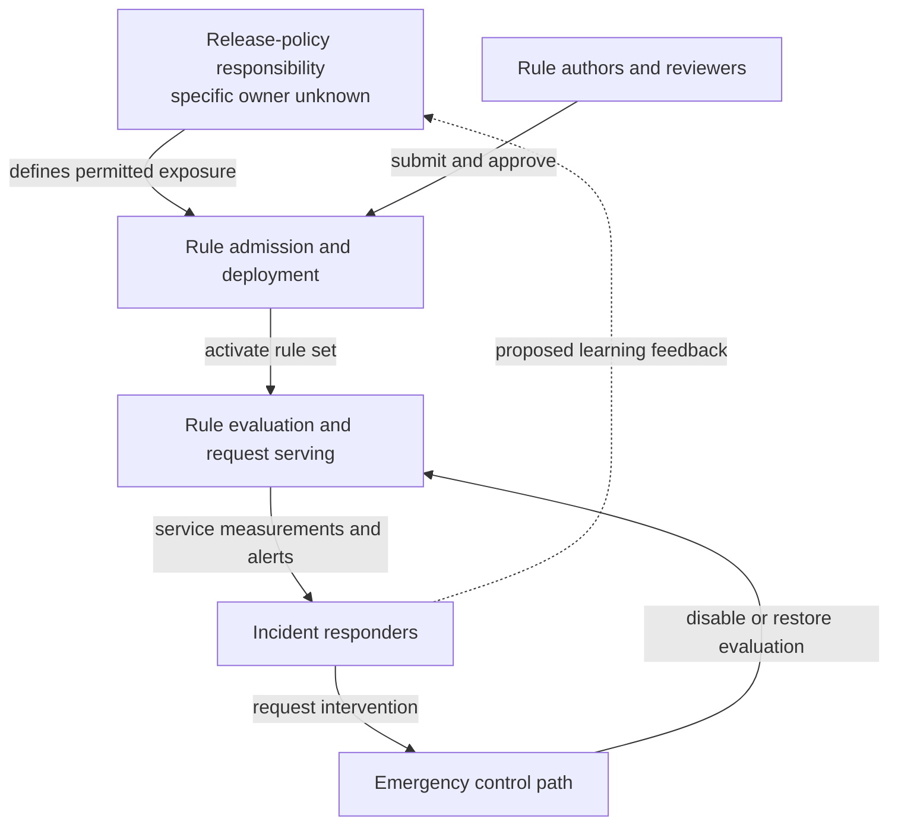

# Cloudflare WAF outage — July 2, 2019

A worked SRE CAST review of a public postmortem.

- **Written:** October 21, 2026.
- **Evidence cutoff:** Cloudflare's July 12, 2019 account, with its July 2 incident update.
- **Status:** completed public-source review; questions for participants remain open.
- **Scope:** rule deployment, request processing, and operational recovery.
- **Sources and passage locations:** [source notes](sources.md).
- **Project task:** [#9](https://github.com/HelixThinker/sre-cast/issues/9).

This is an external interpretation of published accounts. We have no internal
logs, interviews, or implementation follow-up. Cloudflare already describes
multiple contributing weaknesses; this review organizes them into control
questions and decisions an SRE team can use. It does not claim to discover a new
cause or to complete an internal CAST investigation.

## Review outcome

**Interpretation:** the useful design problem is to coordinate three controls:
the execution budget of a security rule, the amount of production exposed to it,
and the ability to withdraw it during degradation. Treating these as separate
responsibilities makes improvement proposals easier to evaluate.

An engineer using this example should leave with three decisions to investigate:
what bounds work per request, what evidence permits broader exposure, and what
recovery actions remain executable when the normal service path is unavailable.

## What the public record supports

These are **Cloudflare-reported observations**, not independently verified facts.
Passage references resolve through [the source notes](sources.md).

| Observation | Passage |
| --- | --- |
| A nonblocking rule still executed against live requests. | [Execution mode](sources.md#execution-mode) |
| Approval and functional tests passed; runaway CPU consumption was outside test coverage. | [Admission](sources.md#admission) |
| Policy permitted worldwide rule deployment for rapid threat response, including this non-emergency change. | [Exposure](sources.md#exposure) |
| A CPU safeguard had been accidentally removed during an earlier refactor. | [Runtime](sources.md#runtime) |
| Access failures and an unfamiliar bypass complicated intervention; ordinary rollback needed two builds. | [Recovery](sources.md#recovery) |

The [July 2 update](sources.md#early-account) reports widespread 502 responses
and an 82% traffic decline at the worst point. It attributes the disruption to
rule-triggered CPU exhaustion and rules out an attack. It does not establish
customer-specific financial loss or data loss.

### Service milestones

All times are UTC on July 2. The [July 2 update](sources.md#early-account)
supplies this compact sequence:

| Time | Reported milestone |
| --- | --- |
| 13:42 | Global rule deployment and outage began. |
| 14:02 | Responders decided to disable managed WAF rulesets. |
| 14:09 | Traffic recovered. |
| 14:52 | Managed WAF rulesets were re-enabled after rollback and checks. |

Traffic recovery and restoration of the disabled protection are different
milestones. The early account rounds the outage to about half an hour.
The detailed account distinguishes command execution from recovery; see
[the precision note](sources.md#timeline-precision). We do not infer an exact
impact interval for every customer.

## Analytical boundary, loss, and constraints

The following are **our analytical framing and proposed requirements**, not
quoted Cloudflare policies.

**Loss in scope:** people cannot complete intended interactions with services
using the affected request path. Revenue, contractual penalties, and actual
exploitation during recovery are outside the evidence available here.

**System boundary:** rule authorship and admission, release policy, distribution,
runtime evaluation, operational feedback, and emergency intervention.
Customer origins and individual applications are outside this review.

Two hazardous conditions guide the analysis:

- Rule evaluation can consume the processing capacity needed for useful traffic.
- Responders cannot reliably change a harmful runtime state while the service
  is degraded.

Corresponding constraints to discuss with system owners:

- Bound both individual-rule work and aggregate request-processing work.
- Increase exposure only while observable service behavior remains acceptable.
- Preserve an authorized way to stop harmful execution under degraded conditions.
- Make temporary loss of a protection explicit, time-bounded, and recoverable.

The third and fourth constraints need a joint availability/security decision.
A generic instruction to disable security automatically would leave that
tradeoff unresolved.

## A control model for the review

This is a conceptual reconstruction for discussion, not a deployment diagram or
an assertion about Cloudflare's reporting hierarchy. Links represent control
actions and feedback. The evidence is the admission, exposure, and recovery
passages above.

The dashed link is an improvement relationship we propose, not an observed
organizational process.

| Control responsibility | Question about the controller's model | Implication to investigate |
| --- | --- | --- |
| Rule authorship and admission | What does a successful result establish about permitted resource use? | An admission result should have a defined scope; conclusions beyond it need separate evidence. |
| Release policy and deployment | What makes a change eligible for broad exposure? | The urgency of a security response and the resource risk of an update require separate decisions. |
| Runtime protection | Which layer enforces a budget when prediction is wrong? | Protection should remain effective even when a rule is functionally correct. |
| Incident response | Which actions are possible with degraded identity, tooling, and service paths? | A documented command is useful only when responders can execute it under the relevant failure conditions. |

These are questions about system design. We cannot infer what a particular
engineer believed from the outcome alone.

## Interpretation of the control gaps

### Admission evidence needs a defined meaning

**Interpretation from the admission and execution-mode observations:** a result
about request classification cannot, by itself, authorize unlimited computation.
The review question is whether the release decision combines all necessary
evidence, rather than whether someone should have noticed a particular pattern.

A useful follow-up is to distinguish three dimensions explicitly: matching
behavior, resource cost, and production exposure. Success in one dimension
should leave the other two visible as separate decisions.

### Exposure must be coupled to feedback

**Interpretation from the exposure observation:** detection can support a safe
expansion decision only while some exposure is still being withheld. An alert
after full activation is a recovery input; it cannot retroactively contain the
initial deployment.

A staged rollout alone is insufficient if the chosen traffic never exercises
the expensive path. The team would need both an exposure policy and a runtime
bound. Their thresholds and observation windows cannot be derived from this
public account.

### Recovery needs an explicit dependency budget

**Interpretation from the recovery observation:** emergency controls should be
analyzed with the failure they are intended to contain already in progress.
The ability to authenticate, reach the actuator, and confirm its effect are
distinct parts of that control loop.

The practical question is which dependencies can be lost together without
removing intervention authority. This review cannot establish the exact
dependency graph, the duration attributable to each obstacle, or whether a
different authorization design would have reduced total customer impact.

### Preserve safeguards across changes

**Interpretation from the runtime observation:** resource containment is a
system requirement whose preservation matters across refactoring. Ownership,
change evidence, and runtime enforcement should be connected.

The public record does not establish why the removal escaped detection, who
owned that requirement, or how competing priorities were handled. Claims about
negligence, understaffing, or a particular organizational culture would be
unsupported.

## Questions to take into the incident discussion

Priority indicates the order of this review's discussion, not Cloudflare's
historical task priority. Suggested respondents are roles, not assigned owners.
All questions remain **open**.

| Priority | Question and evidence to request | Why the answer changes a decision | Suggested respondent |
| --- | --- | --- | --- |
| 1 | What resource ceiling was intended, at which execution boundary, and what happened when it was reached? Request the safeguard's behavior and change history. | Determines whether to isolate a rule, a request, or a broader workload, and what safe degraded behavior means. | Runtime maintainers |
| 1 | What bounded exposure could still meet urgent threat-response needs? Request rollout timings, representative traffic criteria, and emergency exception rules. | Determines a workable promotion policy without inventing an arbitrary waiting period. | Security and release owners |
| 1 | Which recovery dependencies remained usable during the outage, and with whose credentials? Request a dependency map and the intervention sequence. | Determines whether access, authority, transport, or execution is the limiting recovery control. | Incident and identity owners |
| 2 | What assumptions allowed the previous safeguard to change without an equivalent protection? Request the refactor rationale and requirement ownership. | Determines how to preserve the constraint through future implementation changes. | Runtime and engineering owners |
| 2 | What health signals could stop expansion, and how quickly could the stop take effect? Request the release/alert correlation and distribution acknowledgements. | Distinguishes useful deployment feedback from signals available only after broad impact. | Release and observability owners |
| 2 | What evidence would justify restoring protection, and how is the degraded interval communicated? Request restoration criteria and customer guidance. | Balances recovery speed with security exposure and avoids treating restored traffic as the only objective. | Security and incident owners |

## Published actions and additional proposals

### What Cloudflare reported doing

The detailed postmortem [lists these action statuses](sources.md#published-actions)
as of publication:

| Action | Status stated in July 2019 |
| --- | --- |
| Restore CPU safeguard; inspect existing rules | Done / inspection complete |
| Add performance profiling; change regex engine | Scheduled |
| Stage releases; provide edge-bypass capability; automate status updates | Announced |

These are historical statements. We have not established later completion,
present-day architecture, or effectiveness.

### What this review adds for discussion

The proposals below make the intended behavior of those measures more concrete.
They are **our suggestions**, with no assigned owner, deadline, or implementation
claim. They concern the incident system, not additional infrastructure for the
SRE CAST repository.

| Proposal | Related gap | Observable outcome to seek | Decision still needed |
| --- | --- | --- | --- |
| Define a resource-containment contract at the runtime boundary, including an overload response. | Runtime and admission | Inputs with increasing evaluation cost remain within an agreed budget while unrelated requests remain serviceable. | Budget, measurement boundary, and security behavior on exhaustion |
| Define bounded promotion with a stop condition and a constrained emergency path. | Exposure and feedback | A harmful activation can be withdrawn before exceeding the agreed exposure budget; withdrawal is observable. | Representative traffic, maximum exposure, and emergency authorization |
| Demonstrate emergency intervention with normal service and identity dependencies unavailable. | Recovery | Authorized responders can reach the actuator, change state, and confirm the result within an agreed recovery objective. | Which dependencies must be independent, and how emergency credentials remain secure and usable |
| Preserve resource constraints when implementations change. | Safeguard continuity | A refactor cannot silently remove the defined containment behavior; the responsible team can show where it is enforced. | Requirement ownership and evidence proportionate to the change |
| Define separate completion criteria for service recovery and protection restoration. | Recovery/security tradeoff | The degraded interval, restoration decision, and remaining exposure are visible to responders and affected users. | Restoration evidence and communication responsibility |

We cannot claim that any one proposal would certainly have prevented this
incident. In particular, a different regex engine addresses an execution
mechanism; it does not alone settle aggregate resource budgeting, release
exposure, or recovery dependencies.

## How to continue this review

Begin with the three priority-1 questions. Add the relevant evidence beside the
affected conclusion, then revise the control model and proposals. Retain
unanswered questions where access to information is unavailable.

Do not convert a participant's recollection into independent corroboration.
If an answer conflicts with a published account, keep both versions and state
what would resolve the difference.

The [review skill and quickstart](../../skills/sre-cast-review/README.md) use
this sequence: establish the evidence boundary, describe control relationships,
expose decision-changing gaps, and connect proposals to observable outcomes.

## Method note

The [CAST Handbook](https://psas.scripts.mit.edu/home/get_file4.php?name=CAST_Handbook.pdf)
supports considering system boundaries, losses, constraints, controllers,
feedback, contextual explanations, and improvement follow-up. Relevant printed
pages are 9–10, 31–35, 56, and 90–91. The framing, prioritization, diagram, and
proposals here are our SRE adaptation. They are not prescribed Cloudflare
requirements or a mandatory CAST report format.
