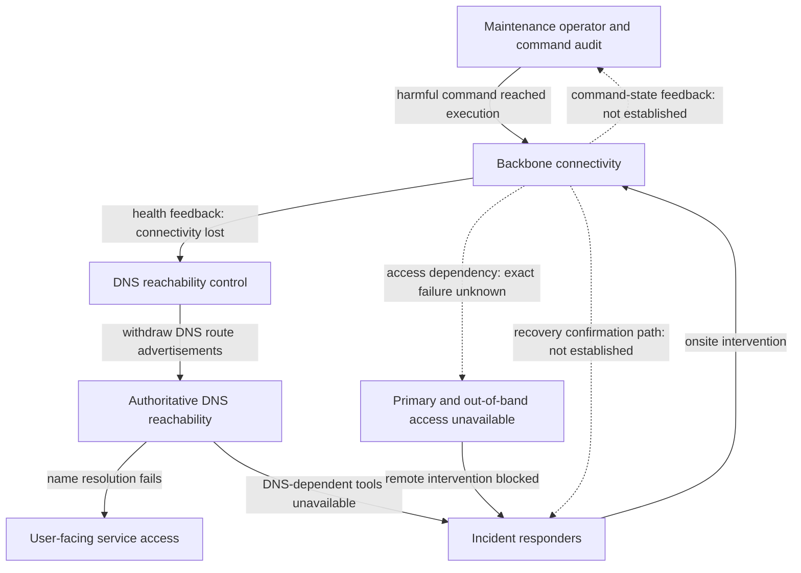

# Facebook backbone outage — October 4, 2021

A worked SRE CAST review with incomplete evidence, using
[`sre-cast-review`](../../skills/sre-cast-review/SKILL.md).

- **Written:** October 21, 2026.
- **Status:** public-source review; internal investigation questions remain open.
- **Scope:** command admission, network reachability, emergency access, and restoration.
- **Evidence:** three public accounts listed in [source notes](sources.md).
- **Project task:** [#10](https://github.com/HelixThinker/sre-cast/issues/10).

## Review outcome

**Our interpretation:** command admission, reachability policy, and recovery
access must be examined together. A maintenance action can change both the
service state and the conditions under which responders can correct it.

The review produces three concrete findings and decision boundaries:

| Finding | Consequence for the incident discussion | Limit on the conclusion |
| --- | --- | --- |
| The reported admission safeguard did not stop the harmful command. | Examine the requested, checked, and executed operation together before choosing a correction. | The specific defect and enforcement boundary remain unknown. |
| DNS-route withdrawal followed the loss of backbone connectivity. | Evaluate the reachability policy under correlated failures, including its effect on operational tools. | A locally intended response is not automatically a faulty policy; the alternative behavior needs analysis. |
| Intervention depended on access and tools affected during the outage. | Treat recoverability as a constraint on the change and access design. | A second transport network is not a justified prescription until the failed prerequisites are identified. |

These findings are interpretations of the
[operator's account](sources.md#maintenance-and-audit) and its
[reachability](sources.md#reachability) and
[intervention](sources.md#intervention) descriptions. They do not establish
individual fault or a complete organizational explanation.

The immediate next evidence is the command/audit record and recovery-path map.
They determine which of the conditional proposals below should proceed.

This example applies the skill's evidence, control, question, and improvement
workflow. It adapts the template to keep unanswered questions central.

## What the available evidence establishes

The [initial Facebook account](sources.md#initial-account) reports a service
interruption following backbone configuration changes and impaired internal
tools. It reports no evidence of compromised user data; that is an attributed
finding, not independent proof of no compromise.

The [detailed Facebook account](sources.md#maintenance-and-audit) says a
capacity-assessment command disconnected backbone links and a defective audit
tool failed to stop it. It describes
[health-driven withdrawal of DNS routes](sources.md#reachability),
[unavailable primary and out-of-band access](sources.md#intervention), and
onsite recovery slowed by security controls.

[Cloudflare's observations](sources.md#external-observations) independently
support DNS reachability loss and routing changes from its vantage point.
Some other Facebook addresses remained routed. These observations do not
independently verify the internal command, audit defect, or access dependencies.
Cloudflare's references to Facebook's explanation remain secondhand for those
internal claims.

### Keep recovery milestones distinct

Cloudflare reports routing changes around 15:40 UTC, renewed BGP activity around
21:00, and `facebook.com` resolution returning on its resolver at 21:20.
These are [external observations](sources.md#external-recovery), not an internal
command timeline or proof that every application had recovered.

We cannot allocate the incident's duration among detection, authorization,
travel, equipment access, and service restoration. Different milestones are
not conflicting accounts merely because their timestamps differ.

## Boundary, loss, and proposed constraints

**Analytical framing:** the loss in scope is inability to use the affected
services. Customer-specific damages and quantified business losses are outside
this review.

Include maintenance authorization and execution, reachability decisions,
operator feedback, emergency intervention, and return to service. Include
security responsibilities where they constrain intervention; leave unrelated
product architecture outside the boundary.

The following are **our proposed constraints**, not documented Facebook policy:

| Hazardous condition to control | Constraint to discuss |
| --- | --- |
| An authorized maintenance action can remove connectivity beyond its intended scope. | Bind the permitted effect and scope to the operation that actually executes, with a defined response when that bound cannot be established. |
| A degraded network leaves responders unable to observe or alter the relevant state. | Preserve an authorized, observable intervention path under explicitly selected failure conditions. |
| After connectivity returns, offered workload exceeds the capacity needed to restore useful service. | Increase load only while observable dependency and service behavior remains acceptable. |

These requirements express desired behavior. The sources do not establish
whether equivalent requirements already existed or where they were enforced.

## Control relationships to investigate

This is a **review model**, not a verified topology or reporting hierarchy.
The [maintenance](sources.md#maintenance-and-audit),
[reachability](sources.md#reachability), and
[intervention](sources.md#intervention) passages motivate the questions.

Solid arrows summarize reported actions, feedback, and effects. Dashed arrows
mark relationships that need evidence; they do not assert a shared physical
network or the absence of feedback. The audit node groups a responsibility and
a safeguard, without claiming their implementation topology.

The two loops are the analytical focus: **command → network → feedback to
command control**, and **responder → network → confirmation to responder**.
Their missing detail is what questions 1 and 2 seek to recover. The DNS branch
shows propagation through another controller, rather than an independent DNS
trigger.

| Role or mechanism | Action and controlled process | Feedback or model question still open |
| --- | --- | --- |
| Maintenance operator and command-admission mechanism | Request, permit, or reject a network operation | What intended effect, target set, and preconditions were visible before execution? Did validation cover the operation actually applied? |
| Reachability decision logic | Retain or withdraw advertisements | What did its health signal establish about serving ability, and what behavior was intended for a system-wide partition? |
| Incident responders and access mechanisms | Obtain authority, reach equipment, change state, and confirm the result | Which step was blocked? Which signals could be obtained without the failing path? |
| Recovery coordination | Increase service load after intervention | Which observations permitted the next restoration step, and what would have stopped it? |

Do not infer a person's beliefs from a command's stated purpose. The record
does not tell us what the operator expected to see, which warnings appeared,
or which alternatives were available.

## Questions that change the next decision

Priority is this review's discussion order. All questions are **open**.
Respondent roles are suggestions, not assigned owners.

| Priority | Question and smallest useful evidence | Why the answer changes a decision | Suggested respondent |
| --- | --- | --- | --- |
| 1 | What operation was requested, validated, and executed, with which target set and preconditions? Request the command record, audit result, relevant versions, and expected behavior. | Distinguishes a wrong constraint, faulty evaluation, and mismatch between validation and execution. These require different changes. | Network automation maintainers |
| 1 | Which dependency failed on each recovery path: transport, naming, identity, authorization, tooling, or equipment access? Request the path map and intervention log. | Determines whether to change a shared dependency, access procedure, or actuator capability. A second network alone may not address the limiting step. | Network, identity, and incident responders |
| 2 | What was the intended behavior when all reachability checks failed together? Request the policy, signal semantics, and decision trace. | Determines whether to revise the policy, its inputs, or the boundary between public serving and operational access. Keeping advertisements active is not automatically safer. | Routing and DNS maintainers |
| 2 | Which recovery delays were required security controls, and which were avoidable dependencies or procedural friction? Request timed steps and the applicable threat model. | Allows a bounded recovery objective without weakening authorization merely to reduce elapsed time. | Security and incident owners |
| 2 | What evidence allowed each restoration step to proceed? Request service-health signals, stop criteria, and recovery exercise scope. | Separates equipment reachability from usable service and identifies what a representative exercise must demonstrate. | Recovery coordinators and service owners |

Questions 1 and 2 should be answered before choosing an implementation.
Questions 3–5 refine the operating constraints and tradeoffs.

## Explanations we cannot choose between

The following are **alternative investigation paths**, not findings about
Facebook:

- A required rejection condition may have been missing or incorrectly
  implemented.
- The admission mechanism may have evaluated different state or scope from
  what the execution mechanism used.
- A recovery path may have retained transport while losing a prerequisite
  elsewhere, or transport itself may have been unavailable.

The current record cannot rank these possibilities or establish that any
particular one occurred. A topology drawn from assumption would hide that gap.

## Published intentions and review proposals

The detailed account describes an ongoing internal review, interest in broader
failure exercises, and plans to strengthen testing and resilience. These are
[publication-time intentions](sources.md#follow-up), not evidence of completed
or effective corrective work. It gives no implementation record sufficient
for this review to assess closure.

Our suggestions below turn open questions into conditional work. **No owners,
deadlines, quantitative targets, or team commitments are established here.**

| Proposal for discussion | Evidence needed first | Observable intended effect | Tradeoff or unresolved choice |
| --- | --- | --- | --- |
| Define and demonstrate the admission boundary for consequential commands. | Question 1 | An operation outside the agreed effect or target scope is stopped before that effect occurs; the evaluated operation can be matched to execution. | Where to enforce the bound, including legitimate emergency exceptions |
| Demonstrate an authorized recovery path under selected dependency failures. | Questions 2 and 4 | A responder can obtain authority, reach the actuator, change state, and observe the result under those conditions. | Isolation, credential security, access time, and required onsite steps |
| Exercise correlated loss of health signals before choosing degraded behavior. | Question 3 | The observed outcome satisfies the agreed serving and intervention constraints when signals fail together. | Retaining reachability versus advertising an unusable service |
| Define separate restoration gates for network access and useful service. | Question 5 | Operators can explain why each load increase is acceptable and detect when to stop it. | Representative signals, acceptable risk, and recovery speed |

These are candidate improvements whose design depends on the answers.
Demonstrating one desired behavior would not prove that the entire historical
incident was preventable by that measure alone.

## Continue when new evidence arrives

Start with the command/audit record and recovery-path map. Preserve this
version's source boundary, then add each new item with its author, date,
scope, and passage or event location.

For each answer:

1. Identify the affected question and state whether it is answered, partly
   answered, or still open.
2. Revise the relevant control relationship and explain which alternative
   explanation the evidence supports or rules out.
3. Narrow, replace, or withdraw the corresponding proposal. Preserve conflicts
   between accounts rather than silently resolving them.

For example, **as a hypothetical update rule, not an incident fact**: if a
recovery log established that transport worked but authorization failed, the
second proposal should focus on that authorization dependency. A recollection
alone would partly answer the question; the path map and log would still be
needed to establish what happened.

No new participant answers are included in this example. Missing implementation
details, owners, and effectiveness evidence remain unknown.

## Method and use

The [bundled CAST guide](../../skills/sre-cast-review/references/review-guide.md)
covers losses, hazards, constraints, controller context, feedback, and
improvement follow-up, with printed references to the CAST Handbook. The
priorities and proposals above are our SRE adaptation.

See the [quickstart](../../skills/sre-cast-review/README.md#review-with-incomplete-evidence)
for an invocation using these sources. The
[Cloudflare 2019 review](../cloudflare-2019-07-02/README.md) provides the first,
more detailed worked example.
