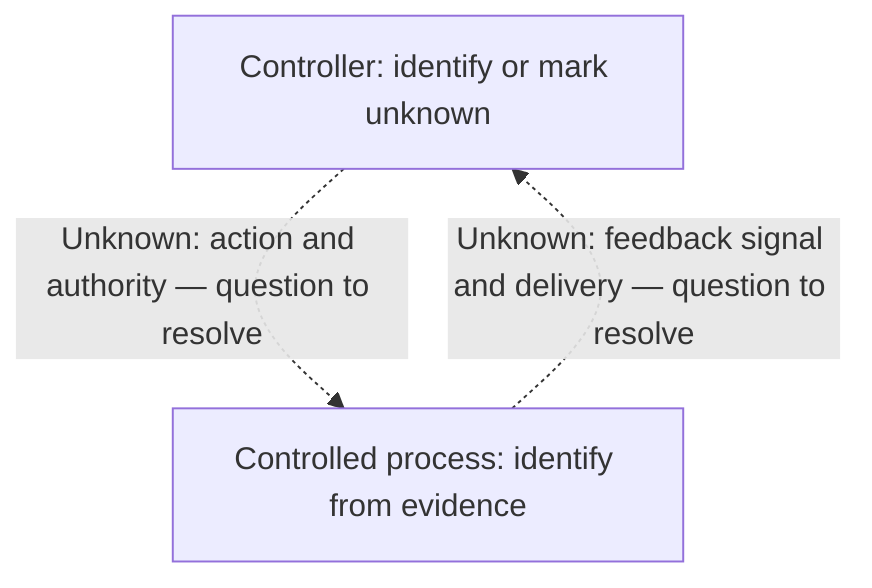

# <Incident> — SRE CAST review

Adapt the headings and layout, but retain concrete findings, a control-and-
feedback diagram, and specific proposals in every review. Replace drafting
cues with evidence-based content or explicit unknowns.

## Review outcome

Lead with the most useful concrete findings and their implications.

| Finding and evidence | Implication for a control or decision | Limit or unknown |
| --- | --- | --- |
| <supported observation or bounded interpretation; source passage> | <what this changes for the engineer> | <what cannot yet be concluded> |

State the next action or decision. With thin evidence, identify the particular
decision blocked by a gap and the evidence needed; do not substitute a generic
statement that more investigation is needed.

## Evidence boundary

State the incident date, scope, evidence cutoff, sources actually read, and
missing context. Identify source versions where they affect the analysis.
Link sources with passage locators; distinguish reported observations from
independently corroborated evidence.

## Supported findings and gaps

Connect important claims to passages. Distinguish observations,
interpretations, hypotheses, contradictions, and unknowns where relevant.
Include only timeline milestones that explain impact, decisions, or recovery.

## Control-and-feedback diagram

Describe the loss, hazardous conditions, and relevant constraints. Label
proposed constraints. Include a compact Mermaid diagram of controllers,
controlled processes, actions, and feedback. A table can supplement it.

This minimal sketch illustrates unresolved relationships. Replace its nodes
and labels for the actual incident; change to solid arrows only when supported.

**Legend:** solid = source-supported relationship; dashed = explicitly labeled
`Unknown:`, `Hypothesis:`, or `Proposed:` relationship. Include only the statuses
used. Name the sources and passage locators supporting solid links; distinguish
operator reports from independent observations. Explain reconstructed groupings.
Tie consequential unknown links to questions below. Undocumented feedback is
not evidence that feedback was absent.

## Questions that change the next decision

| Priority | Open question and evidence to request | Why the answer matters |
| --- | --- | --- |
| <discussion order> | <specific uncertainty; requested evidence> | <finding or decision it could change> |

Suggested respondents, if included, are roles to consult, not assigned owners.

## Improvements

First discuss existing actions, preserving their source, status, and date.
Then include specific proposals motivated by the findings. If the evidence
cannot justify an implementation change, propose a targeted evidence-gathering
step and identify the decision it would enable.

| Action or proposal; status | Related finding or diagram link | Observable intended effect | Unresolved decision or prerequisite |
| --- | --- | --- | --- |
| <source-reported action or review suggestion> | <evidence-linked gap> | <behavior to observe> | <tradeoff, unknown owner, or target> |

Do not infer effectiveness from completion or invent commitments.

## Continuation

List the highest-value missing evidence. For an updated review, summarize
which findings and proposals changed, why, and which questions are answered,
partly answered, or still open. Include the current diagram and update link
statuses only where evidence permits. Preserve unresolved conflicting accounts.

